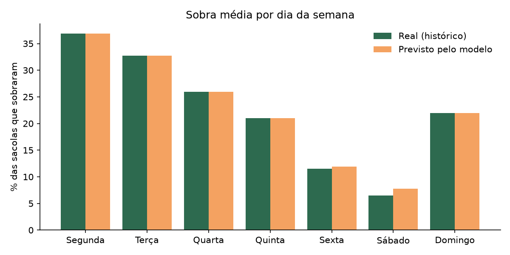
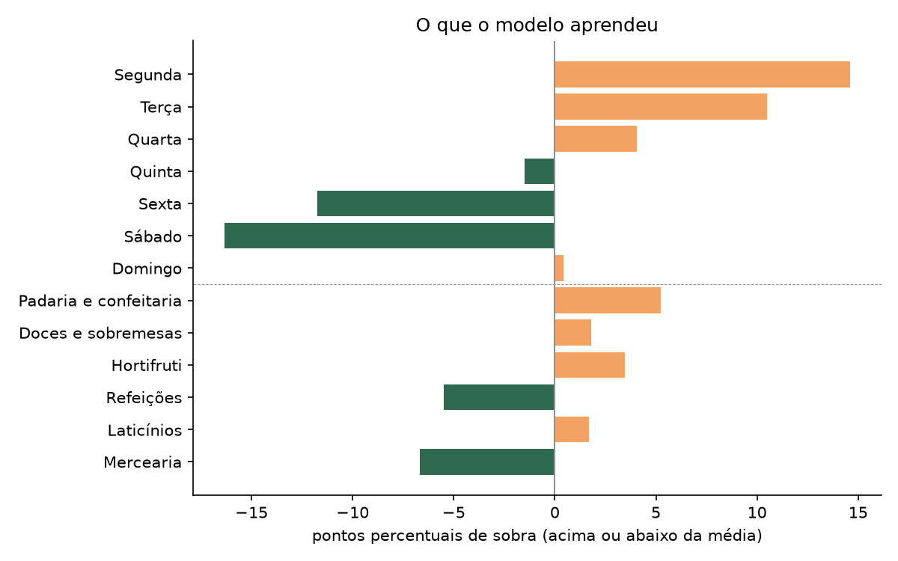

# Resultado do modelo de previsão de sobras

Gerado por `python -m ia.relatorio`.

- Modelo: Regressão linear (scikit-learn)
- Sacolas analisadas: 992
- R² nos dados de teste: 0.68 (de 0 a 1; quanto da variação da sobra o modelo explica)
- Erro médio: 7.3 pontos percentuais (em média, a previsão fica a essa distância da sobra real: se sobraram 30%, o modelo costuma dizer algo entre 23% e 37%)
- Tendência: a cada 30 dias a sobra muda -4.0 pontos percentuais

## Sobra média por dia da semana

| Dia | Real | Previsto |
|---|---|---|
| Segunda | 37% | 37% |
| Terça | 33% | 33% |
| Quarta | 26% | 26% |
| Quinta | 21% | 21% |
| Sexta | 12% | 12% |
| Sábado | 6% | 8% |
| Domingo | 22% | 22% |

Os dados são do histórico gerado por `ia/gerar_historico.py` (12 semanas
simuladas). Com dados reais das lojas, basta rodar este script de novo:
o modelo é treinado a partir do que estiver no banco (RNF28).
